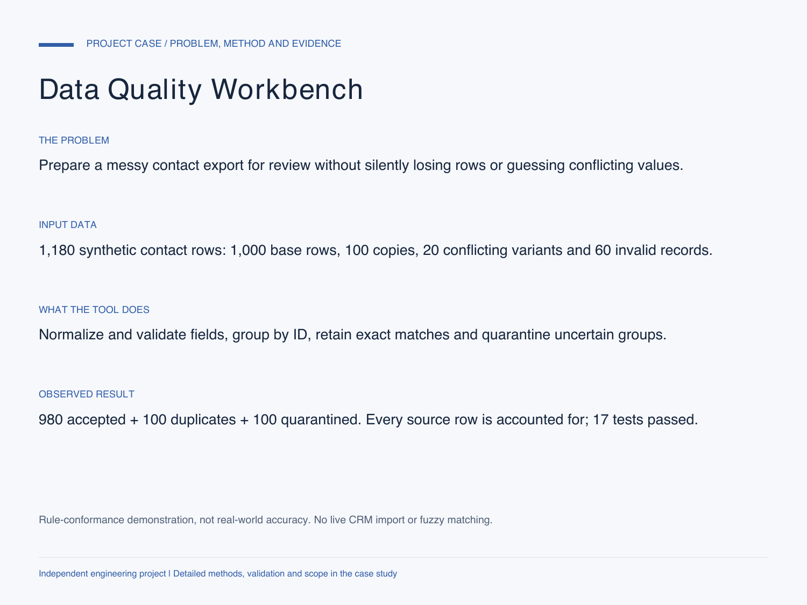

# Data Quality Workbench

**中文** | [English](README_EN.md)

一个可审查的 Python 数据管道，用来清洗 CRM 风格的导出数据，不会悄悄猜测缺失值，也不会擅自合并互相冲突的记录。

[详细案例：问题、数据、方法、证据与局限（英文）](CASE_STUDY.md)

**这是一个独立的工程演示，使用合成的联系人记录，不是生产环境的 CRM 部署。**

## 产出内容

- 一份规范化、已去重的 CSV，可在另行审批后导入。
- 一份完整的源数据行台账：每行标记为接受、重复或隔离，并附原因。
- JSON 证据，保留原始值和规范化后的值，以及输入文件的 SHA-256。
- 一份独立的 HTML 报告，可按处理结果筛选。
- 一份可下载的 Excel 审查快照 `sample_review.xlsx`。

## 复现

需要 Python 3.10 或更新版本。处理管道不依赖任何第三方库。

    python -m unittest -v
    python demo.py --output demo-output
    python data_quality.py your_export.csv --output new-run

每次运行请使用新的输出目录，已存在的输出目录会被拒绝。

用浏览器打开 `demo-output/results/report.html`。输入有六列：`record_id`、`name`、`email`、`country`、`joined_on` 和 `plan`；具体的测试数据生成器和处理规则见 `demo.py`。

## 已验证的测试数据结果

| 结果 | 行数 |
| --- | ---: |
| 输入 | 1,180 |
| 接受 | 980 |
| 规范化后去除的重复 | 100 |
| 隔离待审查 | 100 |
| 未归类的行 | 0 |

100 条隔离行包括 20 个冲突 ID 的双方记录，以及 60 条无效记录。每一条输入行都恰好有一个处理结果。17 个自动化测试覆盖：规范化、重复与冲突处理、缺失或无效字段、输入保留、稳定的重复处理、CSV 公式前缀中和、HTML 转义、表头校验和禁止覆盖。

## 规则与局限

- ID 遵循演示中的 C00001 格式；客户自己的 ID 规则需要显式配置。
- 国家规范化使用明确的 US/GB/CN/AE 映射表。未知国家会被留待审查，不会被猜测。
- 只支持 ISO 日期格式。会检查邮箱语法，但不验证邮箱归属和能否送达。
- 按文档规定，邮箱地址不区分大小写。
- 冲突的 ID，以及包含无效记录的分组，都会被隔离。没有模糊匹配、外部数据补全或实时写入 CRM。
- JSON 保留原始值。面向人阅读的 CSV 会中和类似公式的前缀；但仍应在目标应用中检查表格导入行为。
- `sample_review.xlsx` 是预先生成的快照，包含与公式联动的计数和源数据行台账。其公式在制作它的引擎中检查过重新计算，没有在原生 Excel/VBA 环境中验证。便携的 Python 命令行工具输出 CSV、JSON 和 HTML，不输出 XLSX。

## 项目说明

`verification.json` 记录了测试方法、运行时间和源文件哈希。通过这些检查代表符合合成测试数据的预期，不代表对真实客户数据的准确率估计。

源码、测试数据和明确的验收检查共同说明了演示的能力。不包含任何客户身份、保密数据集、API key 或客户成果。
